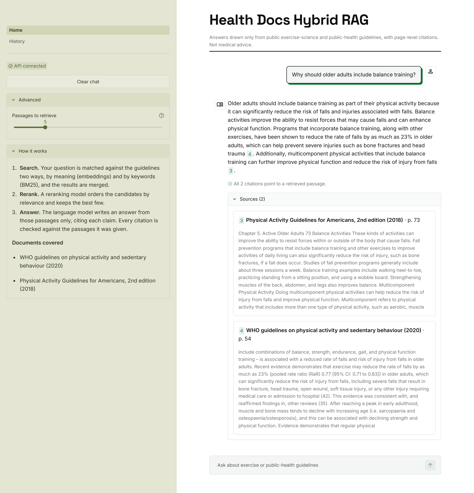
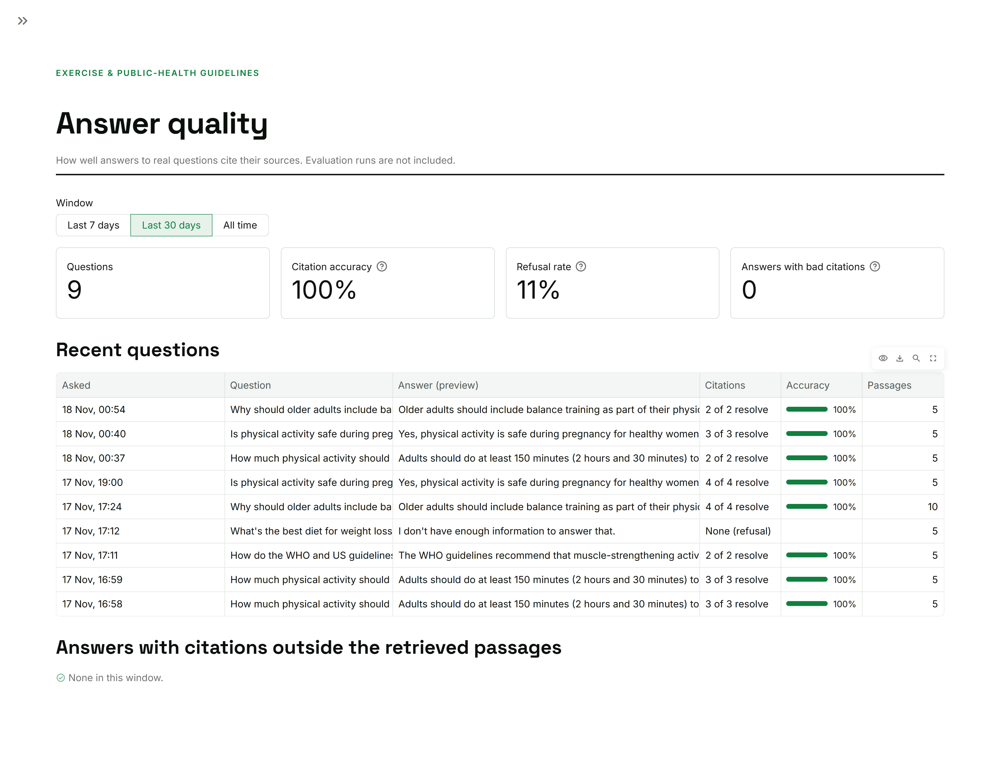
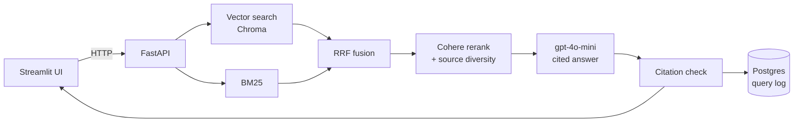

# Health Docs Hybrid RAG

Ask questions about the WHO and US physical-activity guidelines and get answers that cite the exact page they came from, with every citation checked and every answer's quality logged.




## What it does
- **Hybrid retrieval:** each question is searched by meaning (OpenAI embeddings in ChromaDB) and by keywords (BM25). The two rankings are fused with Reciprocal Rank Fusion and reranked by Cohere. A diversity step makes sure comparison questions see both documents.
- **Cited answers:** `gpt-4o-mini` answers only from the retrieved passages and cites them as `[Source N]`. Each citation is checked against the passages the model was given, and the UI shows the cited passages with document and page.
- **Logged and measured:** every query is stored in Postgres with its retrieval trace and citation quality. The History page shows citation accuracy, refusal rate and fabricated citations over time.
- **Eval-gated:** a 40-question gold set with page-level labels, scored by custom retrieval metrics and RAGAS. Retrieval and prompt changes must pass fixed thresholds before merge.

## Results
Eval run 10 (40 questions: 32 answerable, 8 out of scope), current `main`:

| Metric | Score | Threshold |
|---|---|---|
| hit@k (a gold page is retrieved) | 1.00 | ≥ 0.95 |
| MRR | 0.77 | ≥ 0.72 |
| Cited gold page | 0.97 | ≥ 0.90 |
| Citation accuracy | 1.00 | ≥ 0.95 |
| Correct refusals (out-of-scope questions) | 1.00 | ≥ 0.85 |
| False refusals (answerable questions) | 0.00 | ≤ 0.07 |
| Faithfulness (RAGAS) | 0.97 | ≥ 0.90 |
| Context precision / recall (RAGAS) | 0.94 / 0.98 | ≥ 0.90 / 0.90 |

Latency: 3.6 s median, 5.4 s p95 (retrieval + rerank + generation).
Answer relevancy (0.79) is measured but not gated: it scores correct, concise answers as low as 0.56.

## Architecture

Design, data flow, schema and key decisions: [docs/architecture.md](docs/architecture.md).

## Tech stack
| Layer | Tools |
|---|---|
| API | FastAPI, Python 3.12, pydantic-settings |
| Retrieval | ChromaDB, OpenAI `text-embedding-3-small`, BM25, RRF, Cohere `rerank-v3.5` |
| Generation | OpenAI `gpt-4o-mini` (temperature 0), versioned YAML prompts |
| Data | PostgreSQL 17, SQLAlchemy 2.0, Alembic |
| Frontend | Streamlit |
| Evaluation | RAGAS + custom metrics |
| Delivery | Docker Compose, GitHub Actions |

## Quickstart
You need OpenAI and Cohere API keys, plus the two source PDFs in `data/raw/`. The PDFs are not in git; both are free to download:
- *WHO guidelines on physical activity and sedentary behaviour* (2020), saved as `9789240015128-eng.pdf`
- *Physical Activity Guidelines for Americans, 2nd edition* (2018, US HHS), saved as `Physical_Activity_Guidelines_2nd_edition.pdf`

Copy `.env.example` to `.env` and fill in the keys and `DATABASE_URL`.

### Option A: local
```bash
conda create -n askdocs python=3.12 && conda activate askdocs
pip install -r requirements-dev.txt
alembic upgrade head              # needs an existing Postgres database (DATABASE_URL)
python -m app.ingest              # builds the index; calls OpenAI embeddings (costs money)
uvicorn app.main:app --reload     # API on http://127.0.0.1:8000/docs
streamlit run frontend/Home.py    # UI on http://localhost:8501 (second terminal)
```

### Option B: Docker
Build the index once with `python -m app.ingest` (Option A), then:
```bash
docker compose up --build         # UI :8501, API :8000, Postgres :5433, all on 127.0.0.1
docker compose down               # stop (add -v to delete the database)
```

## Testing and evaluation
```bash
ruff check .                      # lint
pytest                            # offline: no API keys, no Postgres, no network
python eval/run_eval.py           # full eval against thresholds (paid API calls)
```
CI runs lint, a migration round trip on Postgres 17, the tests and both Docker builds on every PR. The eval needs the PDFs and paid keys, so it runs locally and its scores go in the PR description.

## Design decisions and limitations
- **Citation checks are structural.** A citation passes if it points at a passage the model was given. It is not proof that the passage supports the claim, and the UI says exactly that.
- **The UI is a thin client.** It talks to the API over HTTP only, so logging, validation and error handling live in one place.
- **Single-turn.** Each question is answered on its own. Follow-up questions would need query rewriting, a retrieval change that has to pass the eval.
- **No authentication** on `/history` and `/ingest`. Every port binds to 127.0.0.1.
- **Not medical advice.** Answers summarise public guidelines and are not a substitute for a clinician.

## Project docs
- [docs/architecture.md](docs/architecture.md): system design, data flow, schema, key decisions
- [docs/ROADMAP.md](docs/ROADMAP.md): progress and what's next
- [docs/record_notes.md](docs/record_notes.md): the concepts behind each stage
